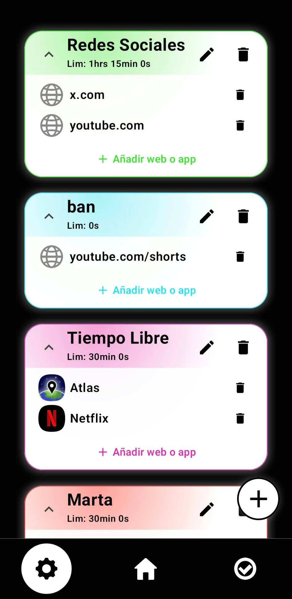
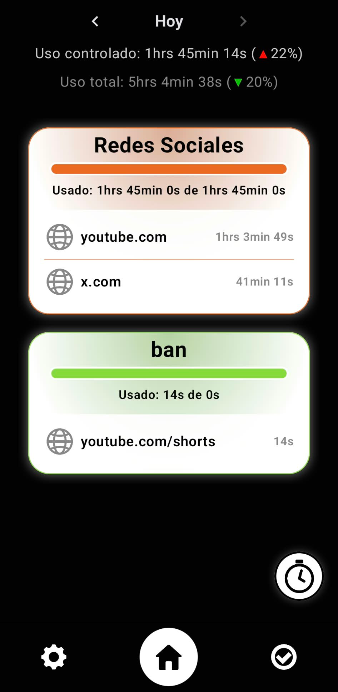
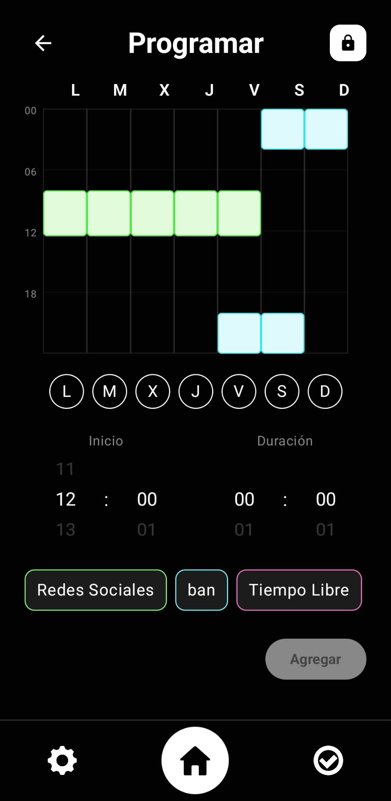

# EarnedTime

**Screen-time control app for Android**: it limits the time you spend on distracting websites and apps through groups with daily limits, and lets you **earn extra time** by completing your own goals.

Personal project built with Kotlin, Jetpack Compose and Room.

Screenshots of the main features:

  

### Usage breakdown
Per-group usage cards with day-by-day navigation and comparison against the previous day.

  

### Pauses
Block groups instantly with a full-screen countdown, or schedule them on a weekly agenda.

  

**[Download APK](../../releases/latest)**

---

## Features

- **Groups**: bundle websites and apps into a group with its own daily time limit. A site or app belongs to one group at a time, and members can be added or removed at any moment.
- **Blocking**: when a group's limit is reached, the website (in the browser) or app is closed. Websites are redirected away; apps are sent to the home screen after a short grace period.
- **Goals**: completing a goal adds extra minutes to its group's limit, with optional daily and weekly completion caps and an expiry date.
- **Pauses**: block groups for a set time, either instantly or on a weekly schedule shown in a week agenda view.
- **Usage breakdown**: per-group usage, navigable day by day.
- **Notifications**: usage reminders as the limit approaches.

## Tech stack

| | |
|---|---|
| Language | Kotlin |
| UI | Jetpack Compose |
| Persistence | Room (KSP) |
| Detection and blocking | AccessibilityService |
| Min. Android version | 8.0 (`minSdk 26`) |

## Technical highlights

### Detecting usage without extra permissions
A single `AccessibilityService` (`GestionUso`) detects the foreground app and reads the browser URL bar through per-browser view IDs. Supported browsers: Chrome, Firefox, Edge, DuckDuckGo, Brave, Samsung Internet, Opera, Opera Mini and Yandex. No data leaves the device.

### Sessions and blocking
- Each visit is tracked as a session, and the remaining time of the group is computed when it opens.
- When the limit is about to be reached, a block is scheduled with a `Handler` runnable instead of blocking a thread. Before closing an app, the service checks that the user is still on it after the grace period.
- Pauses are checked when a session opens: scheduled pauses are stored as minutes from midnight plus a weekday, and instant pauses as an absolute start time.

### Midnight-safe usage tracking
Usage is stored in one row per domain and day. If a session crosses midnight, its time is split between both days, and each part is added to the row of its exact date.

### Single source of truth
Room is shared by the service and the UI. `MainViewModel` collects the Room flows and exposes the state to Compose, so changes made from the service (usage) and from the UI (groups, goals, pauses) always stay in sync.

### Custom Compose UI
Cards use a custom dithered-glow modifier (`drawWithCache` + `Bitmap`) and a shared color palette. The weekly pause agenda is a custom grid built from scratch.

## Known limitations

- Website matching relies on the browser URL bar text; browsers that show only the host can't distinguish routes such as `/shorts`.
- URL bar view IDs differ per browser and may change between browser versions.
- Blocking Shorts/Reels inside apps is not implemented.

## Next steps

- Smarter host parsing for website matching.
- Shorts / Reels blocking.
- Browser extension.

## Author

**Sergio García Serrano** · [LinkedIn](https://www.linkedin.com/in/sergio-garc%C3%ADa-serrano-550925233/) · [Email](mailto:sergiogarciaserrano61@gmail.com)
